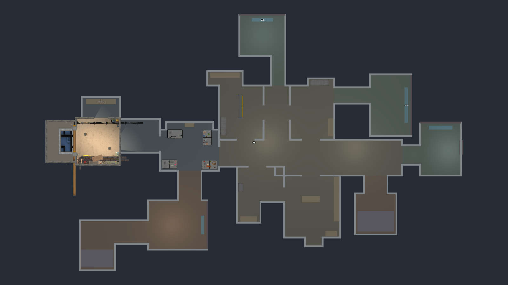

# Compact bunker layout acceptance and publication

**15 November 2026 · HUMAN-ACCEPTED / PUBLICATION VERIFICATION PENDING.** The developer completed Slice 9 without reporting an issue, confirmed conformance to the plan and accepted all nine slices. The major spatial rebuild is closed in its bounded scope. The developer authorized the accepted source and aligned documentation for publication to the existing main branch.

## Why the bunker changed

The collection pivot makes a substantial organized hoard the player's achievement. Extended Expedition playtesting found repeated transit, Food/Hydration pressure, reduced sprint and carry capacity, and fast Fuel accumulation. Those observations motivated testing a shorter layout before detailed economic tuning. Their system-by-system causes remain uncertain. Five partly empty galleries also weakened the intended storage impression. The accepted four-gallery layout concentrates the working areas and retains the entire qualifying storage roster. [Extended playtest](../testing/2026-11-13-expedition-outcomes-and-provisioning-result.md#extended-playtest-findings) · [14 November decision and handoff](2026-11-14-publication-and-layout-handoff.md)

Batch 1 retained Receiving and Dispatch as a coherent installation and shortened Backlog, Sorting, Main Storage and Workshop/Salvager. Batch 2 condensed A/B and the shared junction, shortened Medical and Kitchen, relocated the Incinerator into the former Gallery E region and brought Bunker Ops closer. Nine bounded slices and the developer's walkthroughs established the accepted scene. [Measurements, candidate results and dated acceptances](../testing/2026-11-14-compact-bunker-layout-result.md)

## Accepted working layout

| Area | Accepted result |
| --- | --- |
| Receiving, Backlog and Sorting | Receiving and Dispatch translated +6.75 m east as one authored installation. Backlog is 6.75 × 5.70 m nominal. Sorting has a 10 × 7 m body and an 8 × 1.32 m north pocket after the 1 m playtest refinement. The lift-alert sightline is clear from the verified work stance. |
| Main Storage | Four galleries A–D, shared A/B circulation and the existing C–D link. The hall is 4.30 m clear west and 5.80 m east. Gallery E and its dedicated placeholders and colliders were retired. |
| Medical, Kitchen and Workshop | Medical has a 5.00 m approach. Kitchen has a 6.035 m straight B-east approach and an east counter and staffed core. Workshop branches south from Sorting and leads west to the south-turning Salvager pocket. |
| Incinerator and Bunker Ops | Incinerator is a direct south branch with a 3.00 m corridor and retained 7 × 7 m pocket. A straight 3.00 m east link with 3.00 m clear width reaches the relocated 7 × 9 m Ops room. Its north staffed core and separate east closure remain opaque. The operational Fuel cabinet remains in Receiving. |

*Roof-off diagnostic from the actual Slice 9 Godot run. Normal player views retain ceilings. Material, lighting and furnishing decisions retain their own review scope.*

The accepted census is four qualifying units in A/B/C, 16 surfaces, 3,463 cells, one independent ladder, four Sorting tables and 44 seed hosts and registrations. The collection pivot, physical ownership, schema 11, continuous services and accepted Expedition outcomes continue on this footprint. The paired 6 Bulk walk to Ops was 14.450 s over 51.81 m on the preceding layout and 4.900 s over 16.54 m on the accepted link. That is the measured route comparison. Final stock, capacity, progression and economy remain subjects for later integrated play.

## Evidence and limits

The close-out compared the 22 accepted local paths against the tested Slice 9 postimages and reused the same-state gameplay evidence. It includes 13 of 13 navigation routes, seven focused controller and barrier checks, startup and capture contracts, the initialized census and native New Run and schema-11 Continue in Ops. The geometry suite exited 1 for the two inherited assertions about the direct-wing launch UID and 46 seed hosts. The accepted physical roster has 44.

The Salvager minimum-travel probe is Slice 6 evidence. Receiving desk bounds and CRT formatting retain their historical qualifications. Windows certificate-store and held-item material diagnostics recurred in Slice 9. The 157-Bulk freight case, long-object planner limits, reflection refresh, large-stock autosave cost, silent suspension and release durability retain their existing owners.

VDD v0.12 owns spatial and visual direction. GDD v0.16 and Systems MVP v0.5 received dated same-edition alignment. VDD v0.11, Findings v0.14, pivot and ADR records, earlier diagrams and the cumulative technical history remain available. Later materials, full-wing lighting, furnishing, local playtest refinements, Medical treatment, Workshop/Salvager mechanics and any Fuel/Energy conversion require their own scope. [VDD v0.12 master](../Sorting_Apocalypse_Visual_Design_Direction_v0.12.docx) · [Readable VDD](../readable/Sorting_Apocalypse_Visual_Design_Direction_v0.12.md) · [Current state](../CURRENT_STATE.md)

## Publication verification

The observed preflight local and remote main reference was `4e12a235d858e7357b931813a61b51d9356e8d34`. The accepted cumulative work and aligned masters are the publication set. The receipt will record the source commit after remote main verification.
