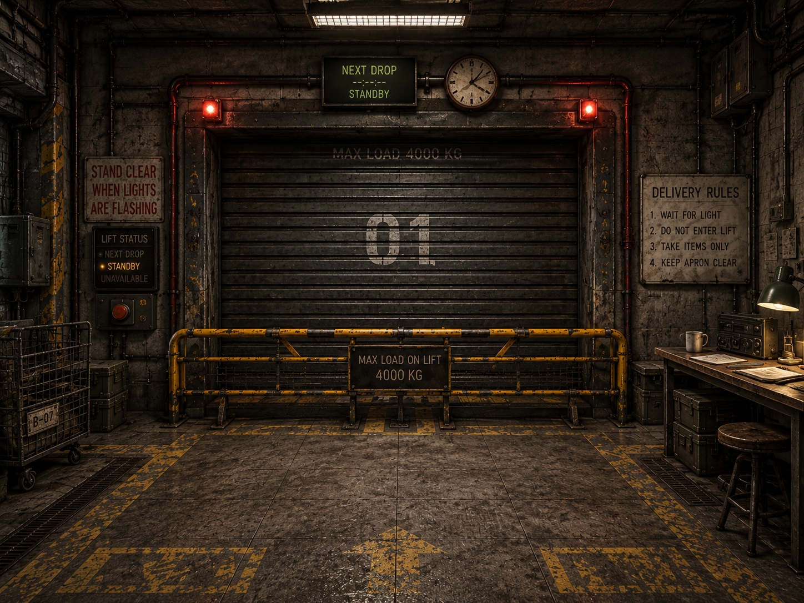
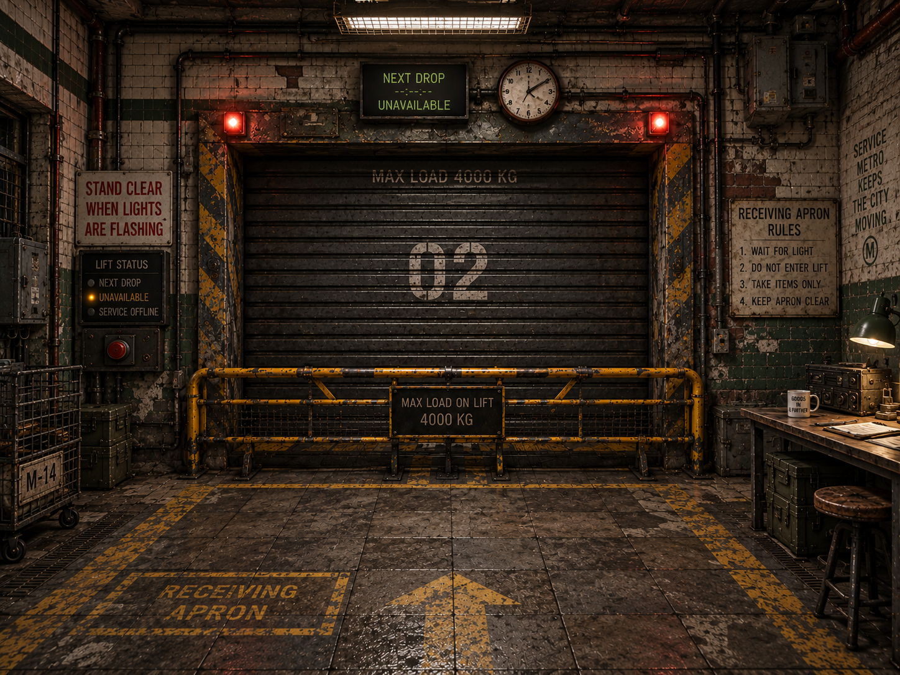
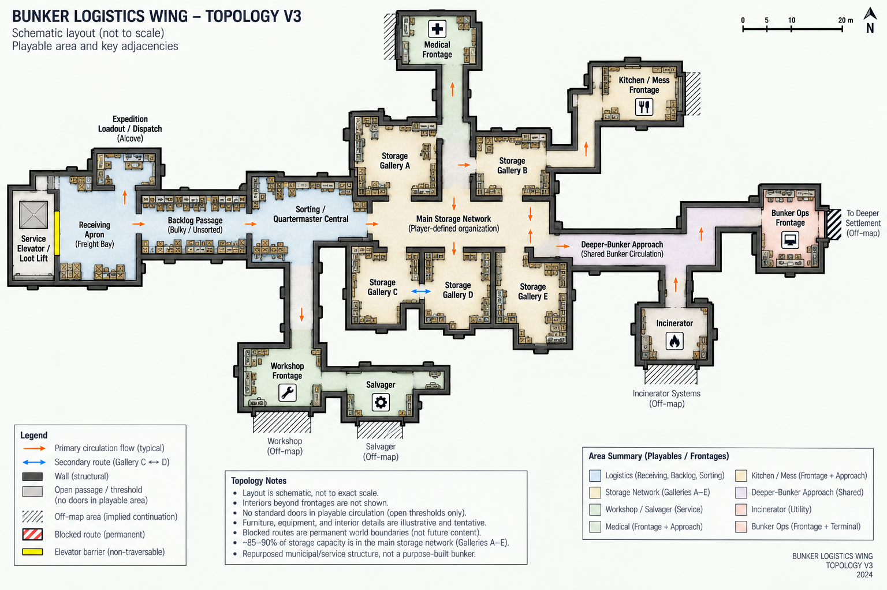
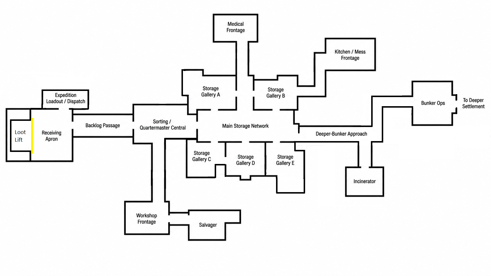
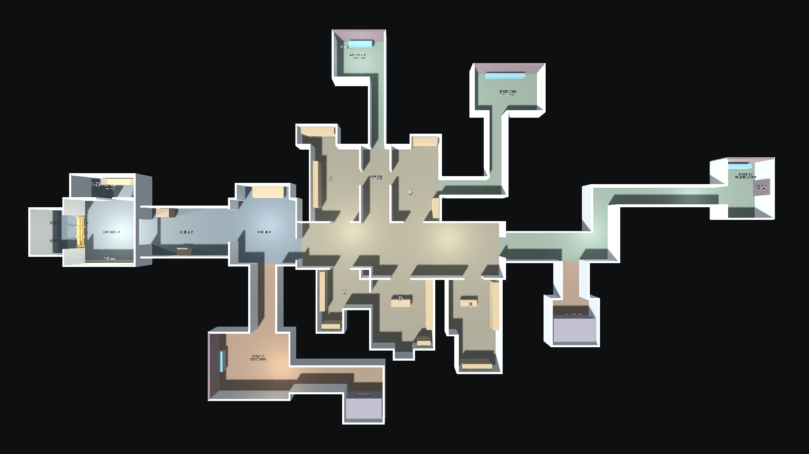
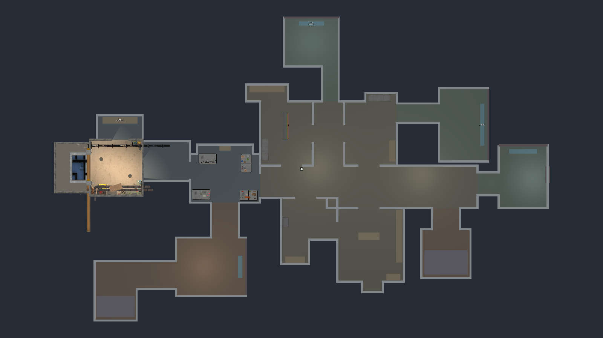

# Sorting Apocalypse Visual Design & World-Building Direction v0.12

> Generated text, tables and images from the DOCX master. 15 November 2026 layout revision. Edit the DOCX first. Pagination, running headers/footers and visual styling are omitted.

SORTING APOCALYPSE

VISUAL DESIGN & WORLD-BUILDING DIRECTION

Unfinished / decommissioned underground service-level bunker

|  |  |
| --- | --- |

Receiving mood references - useful for layering, warmth, material contrast and functional composition. Wear/grime is an upper bound, not the production target.

Version 0.12 | 15 November 2026 | Accepted compact bunker layout

Visual and spatial master for the accepted 15 November bunker. GDD v0.16 governs intended gameplay and Systems MVP v0.5 records implementation. The 14 October visual approval and the 7 November compatibility pass retain their dated scopes.

| CORE VISUAL PROMISE  The bunker should look like a real underground municipal/service structure that has been occupied, adapted, repaired, and organized for years - not like a purpose-built survival base. The player should be able to read what the structure used to be, what later builders changed, what survivors adapted, and what the Quartermaster has made orderly. |
| --- |

## 1. Purpose, authority, and status

GDD v0.16 governs the collection-and-organization game. VDD v0.12 records the spatial baseline accepted by the developer on 15 November 2026 after nine played slices. Systems MVP v0.5 owns implementation and evidence. Findings v0.14 is historical. C1, intentional Receiving lighting, Stage C and M1–M4 retain their recorded acceptances. [38, 39]

This master governs world-building, architecture, composition, materials, lighting and production protocol. GDD v0.16 owns gameplay, goals, progression and interaction. The developer accepted the compact layout and its playable connections. The dated acceptance record tracks publication to main. Materials, full-wing lighting and furnishings have their own later review. [39]

Sections 29 and 31 preserve the original schematics and September greybox overview. Section 39 and the saved builder and scene establish the current spatial baseline. EAF5 remains historical proof evidence, superseded for the Receiving wall role by P05_C02.

| Status | Meaning | Use in this document |
| --- | --- | --- |
| CONFIRMED | Design baseline | Accepted world/art direction at its stated scope; later explicit decisions and GDD v0.16 govern supersession. |
| DIRECTION | Preferred solution | Current spatial or visual recommendation to validate in-game. |
| OPEN / TBD | Unresolved | Exact interaction object, progression timing, balance, labels, dimensions, or topology still requires design/playtesting. |

## 2. Core world premise and identity

| METRO-ORIGIN TEST  The facility's transit ancestry should be archaeological, not iconic. An average player should read “old underground service / municipal infrastructure,” not “subway platform.” A civil or rail worker may recognize the deeper ancestry. |
| --- |

### 2.1 What the bunker was

The survivors occupy part of an unfinished or decommissioned metro-service / maintenance-level construction project. The playable area is not a passenger station and does not expose passenger or rail infrastructure. There are no tracks, platforms, ticketing systems, commuter wayfinding, or long train-tunnel spaces dominating the play area. Collapsed or unfinished tunnel heads may imply civil-engineering continuation without making the player feel that they are standing on a subway platform.

### 2.2 Construction chronology

The visible pre-apocalypse construction spans roughly 30-50 years of mostly late-20th-century civil/service work, interrupted by halted construction, partial resumptions, repairs, and later upgrades. The site was mixed-status before the apocalypse: some completed service areas still received occasional maintenance or utility access, while unfinished expansions and abandoned branches had already been neglected.

- No World War II bunker visual language.
- No futuristic or sci-fi construction language.
- Changes in materials or methods should usually occur at believable construction-phase, repair, or functional boundaries.

### 2.3 Survivor occupation

The settlement has been established for several years. Survivors have had time to organize, patch, label, furnish, ventilate, and operationalize the space, but not to comprehensively renovate it. Major structural work by the survivor community is uncommon. Their skill is expressed through competent adaptation of limited and mismatched resources.

| IMPROVISED DOES NOT MEAN SLOPPY.  Survivor work can be mismatched, ugly, or clearly salvaged while still being structurally sound, logically routed, firmly mounted, and professionally competent. |
| --- |

### 2.4 The apocalypse is context, not decor

The bunker remains a safe haven. The game deliberately shelters the Quartermaster from the surface threat; the player knows the broader zombie-apocalypse premise, but the playable environment does not constantly advertise it. Scarcity, expeditions, repairs, requests, blocked infrastructure, and salvaged objects imply the world state. Routine gore, zombie warnings, combat fortifications, traps, or militarized interior checkpoints would pull focus away from the logistics fantasy.

| REMOVE THE MARKETING CONTEXT TEST  Without knowing the zombie premise, the bunker should still read as a resource-constrained underground community keeping an old facility operational. Knowing the premise should make the same details acquire deeper meaning. |
| --- |

## 3. Historical and visual layers

| Layer | Visual meaning |
| --- | --- |
| Layer A - Original civil/service infrastructure | Concrete, masonry, selective tile/paint, drainage, utility systems, structural bays, old safety/service markings. |
| Layer B - Interrupted construction and later upgrades | Unfinished openings, capped services, material transitions, newer electrical/mechanical additions, repairs, partial commissioning. |
| Layer C - Survivor adaptation | Furniture, patched services, ventilation, shutters, barriers, scavenged equipment, competent improvised installations. |
| Layer D - Quartermaster order | Labels, work zones, storage decisions, clear lanes, paperwork, staging, shelf logic, accumulated logistics habits. |

The layers should remain visually distinguishable. A later layer sits on top of the older structure; it should not erase the evidence that the older layer existed.

## 4. Governing art-direction principles

### 4.1 Readability before spectacle

Environment art supports fast recognition, item retrieval, storage planning, route memory, and interaction. Atmosphere must not obscure shelves, hatches, carried items, request interfaces, or floor circulation.

### 4.2 Low-detail realism, not photorealism

Use strong silhouettes, convincing construction logic, restrained materials, decals, repeated modules, and a limited number of landmark structures. Concept images are composition/mood references, not a fidelity target.

### 4.3 Efficiency is an aesthetic

Clear routes, shallow readable shelves, sensible staging, work zones, and repeatable infrastructure make the Quartermaster fantasy satisfying. Disorder exists, but the environment itself should reward organization.

### 4.4 One bunker, distinct operational districts

The underlying shell remains architecturally continuous. Departmental service spaces also have distinct footprint and approach characters, not the same rectangle repeated with different props. Later lighting, equipment, maintenance, signage and services reinforce identities already supported by the greybox.

### 4.5 Rational architecture, historically caused irregularity

The original facility makes engineering sense. Irregularity comes from halted construction, later upgrades, collapses, awkward annexes, repairs, service penetrations, and years of occupation - not arbitrary level-design geometry.

### 4.6 Structurally trustworthy core

Occupied areas feel worn but dependable. Serious collapse, heavy water damage, or visibly unsafe structure belongs mainly at abandoned edges and blocked continuations.

## 5. Universal material and surface grammar

| THE BUNKER ENVELOPE IS PRIMARILY MINERAL, NOT METALLIC.  Concrete, cement/render, masonry, blockwork, and occasional brick form the building. Metal belongs mainly to reinforcement, shutters, barriers, gratings, pipes, vents, trays, rails, plates, and later infrastructure. |
| --- |

### 5.1 Layered surface hierarchy

1.  Structural substrate / structural surface - concrete, cement, block, masonry, occasional brick, and exposed slabs, beams or columns with their chosen visible material. This is the room's base visual identity.

2.  Applied finish - optional, historically caused paint, tile, render, patch cement, repair field or survivor infill. It is not a mandatory extra visible coating.

3.  Utility/service systems - pipes, conduit, vents, cable trays, electrical boxes, shutters, barriers, gratings and rails.

4.  Survivor occupation - furniture, shelving, lamps, electronics, containers, workstations and practical additions.

5.  Character/detail - wear, grime, localized rust, scuffs, mineral staining, decals, notes, signage and repair marks.

Choose a coherent mineral structural palette before adding finish. A room may pass its base material review with exposed structural material alone. Do not add paint, plaster, tile or contrasting rectangles simply to manufacture variation or rescue a weak structural palette.

An applied finish needs a plausible construction, service or repair cause: an old institutional paint field, cement/render, tile at a wet or service condition, a repair field, overpainted signage or localized later construction. Receiving's accepted NO_FINISH base is a room-specific example, not a bunker-wide prohibition.

| Every new visual layer should look applied to an older one, not as though the whole room was rebuilt in that style. |
| --- |

### 5.2 Wall families

- Concrete-dominant: rough cast, patched, painted, drilled/anchored, with limited damp or repair staining.
- Localized aged glazed tile or institutional service finish where function/construction phase supports it.
- Painted blockwork or masonry in cheaper/later utility areas.
- Survivor plywood, timber, mesh, or corrugated sheet used mainly as patching, infill, partitions, shutters, or retrofit - not as the primary shell.

### 5.3 Floors

Poured concrete is the dominant circulation surface, but a single obvious repeating concrete tile must be avoided. Variation should come from different pours, subtle aggregate/color changes, expansion joints, repairs, traffic wear, drainage, trench covers, short grating sections, steel plates, old safety paint, and survivor operational markings. Large quiet areas remain valuable.

Broad restrained tinted-opacity scalar layers can vary a repeated base material without choosing a new concrete texture for every room. They remain flat editable overlays; changes in underlying pours, joints or construction still need their own plausible history. This technique does not establish seamless mask tileability or alter substrate roughness/normal response.

### 5.4 Paint

Most visible architectural paint belongs to the pre-apocalypse facility: faded institutional green/blue/cream, old safety yellow, bay markings, door surrounds, utility identifiers, and partial color bands. Survivor-applied paint is sparse, newer, rougher, and functional: keep-clear boundaries, hazard edges, storage marks, arrows, or quick labels. Whole-room survivor repainting for aesthetics is out of character.

## 6. Wear, cleanliness, moisture, and irregularity

| Wear is causal, not a uniform “grunge pass.” Active spaces are worn, irregular, and imperfect, but visibly maintained enough to support daily work. |
| --- |

| Cause / location | Expected visual evidence |
| --- | --- |
| High-use contact | Scuffed routes, worn edges, polished/dirty touch points, chipped corners, tape residue, furniture rub. |
| Environmental exposure | Localized mineral staining, rust around fasteners/pipes/drains, grime at wall bases and penetrations. |
| Neglected edges | Heavier dust, corrosion, debris, failed fixtures, older water marks, abandoned construction residue. |
| Maintained work zones | Usable work surfaces, clear walking paths, repaired or isolated serious damage, less accumulated dirt. |

Moisture is localized evidence of being underground, not the bunker’s dominant atmosphere. Active areas are generally dry and habitable. Seepage, puddling, mineral trails, damp corners, and heavier corrosion concentrate around drains, old joints, damaged sections, or abandoned branches.

APPROVED SOURCE/USE ≠ ACCEPTED SCENE COMPOSITION. Local dust, rust, leakage or damage needs a plausible cause, surface and orientation. Broad subtle scalar variation can also break repeated concrete/material patterns and support consistent material reuse across rooms. Its distribution can express construction and accumulated use without requiring every mark to be a tiny crack/chip or an exact microscopic placement. Keep both broad variation and local wear restrained, readable and editable.

The completed human-accepted EAF4 workflow provides eleven standalone conventional presets with live independent dimensions, transforms and appearance, duplication and safe save/reopen. The separate sixteen-source scalar library supports flat tinted-opacity layers and approved opacity modulation; normal authoring does not require gameplay. Infrastructure, furnishings and representative lighting provide the context for localized wear, and later tuning remains ordinary room authoring.

| IRREGULARITY TEST  The player should be able to imagine why neighboring things do not match. The explanation need not be stated, but one should plausibly exist. |
| --- |

## 7. Lighting and color

| Functional coverage without fixture uniformity.  The bunker is lit by accumulated working solutions, not by a designer who specified one fixture schedule for the entire building. |
| --- |

Warm-to-neutral light should dominate ordinary occupied areas. Cooler fluorescent/service fixtures remain part of the mix but should not define the bunker. Replacements do not have to match older fixtures. Task lights, wall lamps, commercial fixtures, and survivor replacements can coexist. Harsh uniform industrial light should be limited because it is tiring, visually unforgiving, and pushes the world toward lab/military/warehouse language.

- Receiving: warm/neutral general light plus industrial task and warning accents.
- Sorting: comfortable work lighting with good monitor/surface readability and warmer local task sources.
- Storage: calm, legible shelf illumination; avoid deep item-obscuring shadows.
- Medical Supply Anteroom: somewhat brighter/neutral, but never overexposed clinical white.
- Workshop/service leg: more directional industrial sources, still avoiding blanket harshness.
- Unused/dead branches: reduced coverage, spill light, failed/absent fixtures, but not horror-game blackness.

Architecture stays mostly neutral: concrete grey, dirty off-white/cream, faded green/blue, dark steel, oxidized metal, plywood/wood, and safety yellow. Strong color belongs to functional accents, warning lights, facility identity, loot, and restrained Quartermaster labeling.

Neutral Calibration is the standard material and architecture review context; Receiving Target Preview is a target-context comparison. Neither defines the final fixture schedule. Review the structural/material composition in neutral light before using atmosphere, and do not turn the EAF1 WallGrazing diagnostic into production lighting direction.

Receiving now uses deliberate warm apron practicals, balanced cage task lights and a bounded ceiling-bounce approximation. WorldEnvironment ambient is intentionally disabled and KeyLight hidden/off; retained background, exposure and Filmic tonemapping still operate. One essential local reflection probe and its established refresh owner remain. A30WS is historical lighting context, superseded by §34.7 and the later human-authored scene. [37]

Purposeful room lighting is the current direction, with no automatic broad ambient/KeyLight floor. It does not permanently prohibit every future intentional ambient contribution. A global policy change, new fixture system or rendering system still needs deliberate design discussion; unfinished neighboring rooms need their own lighting decisions. [37]

The local Fuel slice applies 1.000, 0.835, 0.670 and 0.500 to authored working light strength. Normal power restores the authored values. UI, goal information, indicators, targeting and interaction assistance keep their ordinary behavior. See GDD §14. [38]

The two eastern fills were reused for the new link and Ops with 3.00 m and 6.50 m ranges, retaining color, energy and Fuel bindings. Shared fills remain at their accepted positions. The dim Kitchen and Incinerator still show legible prompts. The accepted spatial work leaves whole-wing final lighting for a later art review. [39]

## 8. Signage, labels, humor, and human traces

| Generation | Character |
| --- | --- |
| Legacy facility signage | Sparse. Utility IDs, hazards, load limits, construction/maintenance marks, partial bay numbers. The project was never fully finished, so polished wayfinding is limited. |
| Survivor operational signage | Hand-painted/printed instructions, warnings, return procedures, scavenged signs reused pragmatically or humorously. |
| Quartermaster organization | Most systematic and readable layer: restrained labels, tags, category cues, staging instructions and storage references. Exact player-labeling mechanics remain TBD. |

Humor should be dry, situational, and human rather than zany or meme-heavy. A scavenged road sign, passive-aggressive maintenance note, absurd old prohibition sign, or sarcastic label can work because it feels like something residents chose to keep. Do not turn every wall into a punchline.

### 8.1 Workplace first, domestic traces second

The logistics floor is a workplace that has gradually become the Quartermaster’s de facto living space. Appropriate traces include a small sink, mug, plates/cutlery, thermos, coat, pens, notebooks, a comfortable chair, a hardy plant, or a few personal notes. There is no dedicated bedroom, lounge, or recreation corner in the playable logistics wing. Personal objects should usually have a practical reason to be where they are.

## 9. Authored-world and unseen-community rules

| The playable environment is authored and spatially persistent. Decorative storytelling objects do not autonomously move, appear, disappear, or get cleaned up to simulate unseen NPC activity. |
| --- |

Physical changes occur only through explicit player-legal actions or designed system transitions. Unseen residents are communicated through requests, audio, hatches, lights, deliveries, machinery state, one-way messages, and static environmental evidence - not ambient prop simulation.

The bunker leader is referred to as the Administrator. The Administrator and other residents remain physically off-screen. One-way operational messages may carry tutorials, upgrade confirmations, exposition, warnings, and personality; the Quartermaster does not need branching dialogue or visible NPC conversations.

Physical storage installation is authored world state. The developer selects furniture, placement, dimensions, levels, per-instance Front and ladder availability. The player changes zones, labels and organization within those installations; no free-build mode follows. The favored all-storage-available-from-start direction is addressed in §15.1, not by automatic scene changes. [38]

## 10. Universal environment-production protocol: the Foundation Gate

| Every major space must independently pass Layer 1 - Structural Shell and Layer 2 - Applied Finish before later services, furniture, dressing or final lighting carry the composition. Layer 2 may pass with coherent exposed structural materials and no added finish. |
| --- |

### 10.1 Layer 1 - Structural Shell

- Dimensions and proportions; floor/ceiling levels; walls and major openings.
- Recesses, alcoves, columns, beams, circulation, sightlines, and relationship to implied off-map spaces.
- Assign credible construction ownership at joins. Prefer clean face ownership, avoid visible coplanar overlap, and use through/butt joints where the build logic supports them. Faces completely concealed by adjacent opaque construction may be omitted; standalone pieces remain closed solids by default.
- An accepted gameplay topology may receive a production visual-shell substitution without spatially rebuilding the room. Preserve openings, circulation and sightlines unless later focused evidence calls for change.
- Architecture must make sense before attractive equipment, clutter, or lighting is added.
- Human visual approval required during prototype environment development.

| Layer 1 review question: Does this feel like a plausible part of the underground facility before we add anything interesting to it? |
| --- |

### 10.2 Layer 2 - Applied Finish

- Choose the visible structural wall, floor and ceiling materials as one coherent room palette, at plausible physical metres-per-repeat.
- Add paint, tile, render or repair fields only where history or function causes them; no extra applied coating is required.
- Review baseline surface character and construction-phase transitions without relying on later contextual wear to make the palette work.
- Review on standardized geometry under Neutral Calibration and relevant target-preview lighting before relying on final atmosphere.
- Human visual approval required before later passes.

| Lighting may enhance a good material composition, but it must not be used to hide a bad one. |
| --- |

### 10.3 Later layers

1.  Layer 3 - Services / infrastructure: pipes, vents, conduit, machinery, barriers, shutters, functional lighting.

2.  Layer 4 - Survivor occupation: furniture, workstations, storage, practical additions.

3.  Layer 5 - Character/detail: signage, notes, small props, humor, localized grime and storytelling.

The Foundation Gate remains a production-art checkpoint. Neutral storage and Stage B interaction success did not itself promote the art layers. The developer has now accepted Receiving’s completed production environment collectively, closing C1 on 11 October. Minor wear/furnishing/lighting adjustments remain ordinary room authoring and do not automatically reopen C1. EAF5 remains historical proof evidence. [36]

EAF5 confirms that the gate separates structural shape, structural surface material, optional applied finish, localized wear and lighting. These owners can be revised independently. Human visual approval remains the gate; a technically valid material or mesh is not automatically right for a room.

## 11. Spatial and architectural grammar

- Human-scale service spaces: Most areas are larger than domestic rooms but remain contained and practical. Receiving, junctions, and machinery bays can be selectively larger; dead ends may tighten.
- Mixed exposed services: Original infrastructure is partly concealed and partly exposed. Survivor additions are often surface-mounted. Not every wall or ceiling needs pipes, vents, or cables.
- Exposed structural ceilings: Concrete slabs/beams remain visible; services and fixtures accumulate selectively below them. Uniform dropped ceilings are rare.
- Visible modularity: Repeat structural bays, wall and floor joints, columns, ceiling spans and service standards where useful. Repairs, later phases and local function can interrupt that rhythm. Use the accepted compact geometry and purposeful irregularity as the working baseline. Future local details can support function and wayfinding without adding repeated transit. [39]
- Controlled access without militarization: Heavy doors, locks, shutters and barriers appear only where function requires them. Normal playable circulation defaults to open thresholds/doorways without routine operable doors, preserving flow and sightlines. Fixed closures are reserved for off-map boundaries, blocked continuations, freight machinery, and similarly justified hard limits.

## 12. Core logistics relationship: Receiving → Sorting → Storage

The accepted logistics spine runs from Receiving through shortened Backlog and Sorting into Main Storage. Four galleries and their shared connections branch from the hall. A straight 3 m link leads east to Bunker Ops. Open thresholds keep travel and sightlines legible. Sorting remains optional staging outside qualifying victory storage. [39]

### 12.1 Backlog transition

Backlog is 6.75 m east–west by 5.70 m north–south nominal, with 5.40 m clear depth. Its held north side and moved south wall shorten the route between Receiving and Sorting. Keep the working lane clear. If later dressing calls for a backlog of non-loot objects, place it within the available footprint and use clearly distinct forms such as wrapped pallets or obsolete equipment. [39]

| Receiving = incoming uncertainty. Backlog passage = unresolved leftovers. Sorting = temporary deliberate staging. Storage = resolved organization. |
| --- |

## 13. Receiving Apron / Freight Bay

Receiving is a former freight/service loading point adapted into a goods-transfer interface. It is somewhat rougher and more overtly industrial than Sorting/Storage, but the permanent concrete/masonry structure remains visually dominant. The service elevator itself is the only spatial implication of the surface/outside-world conduit: there is no playable lateral surface-access route, signage, or explanatory corridor beside the lift.

- Architecture first: adapt freight equipment to the existing accepted aperture and surrounding wall, not the room to a prefab doorway. Dispatch is the accepted shallow external annex beside Receiving with its own doorless opening; keep its usable volume distinct from the apron. It is not a new destination corridor.

Receiving retains 8.00 × 7.50 m and 60 m². Dispatch retains 6.50 × 3.50 m and its 2.40 m doorway. Both moved 6.75 m east together, with the freight and lift installation and its hand-authored relationships preserved. The 2.84 × 3.40 m clear Backlog attachment is now at X −21.75. See §34.7 for retained art, theatre and lighting evidence. [39]

- Wide and shallow: Construct a distinct rectangular freight enclosure behind an aperture in the Receiving west wall. Solid room-wall sections flank the opening; the cage has its own inset rear wall, side walls, floor and ceiling. The rear of the cage is not the apron's surrounding wall. A permanent barrier keeps the shallow bay inaccessible; no route around the cage is implied. [H16]
- Barrier: A strong example of competent survivor improvisation. It may combine repurposed industrial parts, but must look firmly anchored and intentional.
- Shutter: Heavy, simple, mechanically understandable, battered but functional. Corrugated/segmented metal belongs here because it is equipment, not the shell.
- Floor: Concrete with repair patches, drainage/trench/grate interruptions, faded hazard/keep-clear markings and cart/freight wear.
- Services: Moderate and localized around freight machinery, one service wall, or ceiling edge. Leave significant concrete surfaces visually quiet.
- Wear: Usage wear more than neglect; the inaccessible freight recess can be somewhat rougher.
- Signage: Load limits, bay ID, emergency stop, concise receiving rules, sparse Quartermaster notes, occasional scavenged humor.

The promoted Stage B TAKE-only presenter arranges front crates, rear pallets and loose deck cargo within a shallow permanent freight bay. Keep a clear player-side work apron and preserve the accepted presentation and interaction geometry as production fixtures are developed. Fixture-integrated Receiving-only TAKE reach is 3.4 m; it is a spatial/interaction constraint, not a visual invitation to enlarge or clutter the bay.

Receiving production uses P05_C02: the approved constructed/panel wall, Worn Concrete Floor and shuttered/formwork ceiling. Base applied finish, structural secondary and fixed base wear preset remain NONE; these base choices do not exclude independently authored wear layers. The EAF5 P01_C02 primary/P05_C03 alternate remain historical proof selections (§34).

Receiving C1 and Stage C remain CLOSED / HUMAN-PROMOTED. Fully-OPEN TAKE, live read-only CRT and the stationary bay/deck/barrier with shutter/audio theatre are accepted. Admission releases healthy crew even when an admitted load must wait at the closed lift for an emergency start. The local CRT keeps STATUS, DECK and QUEUE, with green normal and orange emergency mode text. A pending start shows WAITING and its remaining active seconds. Existing deposited slots/CRT counts are implementation facts, not a cap on target waiting returns. Dispatch furnishing/lighting and sill material remain separate. [37; 38]

Dispatch preparation is one current crew at a time: choose 1–4 available Ready scavengers, equip and select two affinities, then explicitly send it. Another crew can follow consecutively in the same interface session. Do not furnish or specify parallel preparation tabs or a morning roster; an overview of already dispatched teams is separate. The preparation panel is tentatively live, not paused. [38]

### 13.1 Sorting sightline

The accepted work stance retains a partial westward view of the lift through Backlog. The final loaded walkthrough verified the eye-height line to the W1 alert lens in the translated Receiving installation. Stage B still establishes deterministic cargo identification and fixture-integrated TAKE reach in its promoted scope. Preserve those working views when adding furniture or finishes. [A17, 39]

## 14. Sorting / Quartermaster Central

| Sorting is a widened logistics work area at the Receiving-to-Storage junction. Its accepted floor gives the Quartermaster room to turn and stage items without turning the tables into qualifying storage. |
| --- |

- Sorting work surface: retain a wide, shallow, clear usable surface conveniently reached from the work area. The four installed tables, seed hosts and greybox desk aid establish the current authoring setup. Final furniture selection and clearance are later placement decisions.

The sorting table and carried bundle remain legal temporary staging but do not count toward the stored-Utility objective. Qualifying storage and its totals are defined by GDD v0.16, not by a furniture model’s appearance. [38]

- Information equipment: wall-mounted or ceiling-hung ordinary monitors beside/above the sorting surface, not on its usable area. Essential eight-category goal progress is baseline and never lost to upgrades, penalties or events. Active elapsed run time replaces a required simulated-day clock. Journal/ledger versus monitor presentation remains open. [38]
- Spatial relationship: the main body is 10 × 7 m with an 8 × 1.32 m north pocket, for 8.32 m overall depth. The initial 10 × 6 m body gained 1 m to the north after playtesting to restore working space at the desk. The eye-height lift-alert view and the turns toward Storage and Workshop are retained. [39]
- Personality: a small sink, auxiliary surface or cabinet can support the Quartermaster’s work. Match the final roster to the accepted working lanes and usable space around the desk.
- Infrastructure: Restrained; the scene is already information-dense. Quiet wall/ceiling surfaces are valuable.
- Starting state: Functional but imperfect, reflecting an experienced Quartermaster with established routines and a backlog of “tomorrow” tasks.

## 15. Storage galleries and alcoves

| Storage is an adapted architectural condition, not a purpose-built stockroom. The Quartermaster fits capacity into inherited underground geometry and works around pillars, beams, wall jogs, ceiling constraints, and circulation compromises. |
| --- |

The accepted layout has four galleries, A–D. A and B occupy the shortened north bank and C and D occupy the south bank. The old 85–90% capacity distribution is a historical design reference. GDD v0.16’s roughly 80% occupancy aspiration remains provisional and independent of the room count and installation census. [38, 39]

- Circulation: one condensed Main Storage hall with a 4.30 m clear west section and 5.80 m clear east section. A deliberate short link between C and D still makes a useful loop. The A/B common passage remains Main Storage circulation. [39]
- Partial enclosure: Existing walls, columns, offsets, broad doorless openings and restrained orthogonal wall jogs create distinct pockets while keeping adjacent areas perceptible. Irregularity should be purposeful and buildable; avoid puzzle-like outlines or decorative micro-alcoves in the initial shell.
- Access and capacity: retain A-east and B-west into the shared junction, plus the C–D secondary link. Reach Medical via the shared junction and Kitchen via B-east. The branches end at their own opaque staffed boundaries. [A17, 39]
- Shelf placement: Predominantly perimeter/wall fitted, but gameplay usability governs. Wall shelves should be shallower; deeper units belong where the player can walk around them.
- Facing: Front is semantic metadata authored per installation, not inferred from which open side appears to be the front. Different instances of the same furniture family may use different Front states.
- Stored presentation: Default labels and presentational faces should read toward unit Front when their canonical item pose is authored that way. A 90-degree packing choice may intentionally turn them sideways.
- Do not author per-item shelf-family rotation hacks or mutate imported source orientation to repair one installation's presentation.
- Freestanding units: Generally low-to-medium height to preserve sightlines. Taller islands are exceptions proven through first-person testing.
- Shelf height: ordinary ground-access storage still needs reliable visibility, targeting and retrieval from supported standing approaches. Selected authored taller installations may use the human-promoted fixed-ladder architecture where a deliberately installed ladder serves the shelves. This does not make every high shelf, rack or route ladder-accessible.
- Furniture language: Coherent backbone of a few repeated general-purpose families, supplemented by scavenged cupboards, lockers, crates, low units and specialist storage.
- Player agency: all four galleries have soft spatial affordances and open category use. A is near Sorting, B serves the east turn toward Kitchen, and the irregular south galleries C and D share a short passage. Their shapes aid spatial memory. The player decides what goes where.

Player-authored organization remains free: galleries have no prescribed category quotas or neatness score. A crowded winning collection should still allow retrieval, replacement and reorganization. Reaching all eight live category targets is sufficient; empty intake or perfectly cleared staging is not an additional goal. [38]

### 15.1 Authored storage installation and progression status

Storage remains spatially authored, with no free-form shelf placement. The favored collection-game direction makes the storage installation available from the start rather than unlocking shelves through upgrades. Exact capacity and furnishing remain to be tested; this is not permission to add units to the existing scenes. Any retained furniture movement still needs explicit unit/socket rules. [38]

Each installed unit retains its authored semantic Front, level distribution, dimensions and usable-area insets. Different instances of one furniture family may face differently; this belongs to the installation, not the mesh family. Those physical contracts remain applicable without a storage-upgrade tree.

The former night/socket upgrade sequence is historical. The rebuild removed the obsolete fifth gallery and its dedicated shelf envelopes, island and collision. Existing environmental clutter and functional storage in the accepted areas retain their authored purpose and ownership. [38, 39]

Production starting stock, final usable capacity and the winning assortment remain balance questions. A substantial hoard should leave practical maneuvering space rather than require geometric precision. The illustrative 2,000 Utility per category and roughly 80% occupancy do not specify shelf counts, dimensions or another completion condition. [38]

The accepted census has four qualifying units across A/B/C, 16 surfaces, 3,463 cells, one independent ladder, four Sorting tables and 44 seed hosts and registrations. The storage units retain their dimensions, Front, clearances, identities and positions. [39]

## 16. Dedicated service spaces and inner facility boundaries

| VISIBLE SUPPORT SPACE, UNSEEN STAFFED CORE. Workshop / Kitchen service rooms and the Medical Supply Anteroom are playable; Bunker Ops is an open Transfer Landing. Opaque inner boundaries exclude only the staffed operation, not the support-space footprint. |
| --- |

CONFIRMED  Workshop and Kitchen have dedicated player-accessible service rooms; Medical has a Supply Anteroom. Bunker Ops uses a more open, dedicated Transfer Landing. These are supporting departmental spaces that plausibly need no continuously visible worker, not staffed workplaces emptied of people. Their functions include material handoff, equipment support and limited staging, rather than overflow storage alone. [D16S]

The staffed fabrication floor, treatment ward, cooking/mess interior and administrative office remain unseen beyond opaque boundaries. The accepted service rooms provide enterable floor for arrival, turning and handoff. Departmental furnishing and delivery choreography remain later design.

### 16.1 Three separate boundaries

| Boundary | Player-facing meaning | Greybox obligation |
| --- | --- | --- |
| Territorial | The player enters department-owned support space. | Open traversable entrance / defined landing edge; room identity cannot depend on a door blocking entry. |
| Material ownership | Supplies transfer only through an explicit legal submission action. | Use the interface envelope at the inner boundary. Existing service panels own legal handoff. Territorial entry preserves item ownership. |
| Playable world | The staffed operation stays outside the playable domain. | Continuous opaque inner wall / fixed closure behind usable room floor. No accessible operational core or exposed empty room beyond it. |

### 16.2 Distinct footprints; bounded implementation scope

Workshop remains broad and distinct, Kitchen carries an elongated east-frontage room, Medical widens west of its approach, and Bunker Ops is a dedicated landing. Their accepted footprints, entry offsets and clearances are in the saved geometry and §39. [A17, 39]

The accepted wing supports schema-11 continuation, Dispatch, natural recovery, Kitchen, deliberate disposal and the Receiving Fuel cabinet. M1–M4 remain historical fixtures. Final departmental furnishing, handoff choreography and deferred service mechanics retain their owning scopes. [D16S, D17B, 39]

Department ownership adds no implicit free Quartermaster capacity, retrievable reserve, automatic submission or autonomous prop handling. The retained physical handoff is irreversible. Request cadence, bounded escalation, treatment, Workshop progress and output timing follow GDD v0.16’s owning sections and open questions, not the former daily equations. [38]

## 17. Workshop Service Room / service leg + Salvager

Workshop branches south from Sorting through a 5.00 m approach with 3.70 m clear width. Its 84 m² nominal room is approximately 10.03992 × 8.36660 m, with the staffed-core wall and interface on the east. The continuous southern wall and west Salvager exit define the room. [A17, D16-R02, 39]

Workshop functionality is under redesign. Carrying, expedition and optional information improvements remain candidates; no storage tree, productive-night requirement or construction timing is supplied by the room design. The project roster and any presentation transition require their own decisions. [38]

- Footprint and arrival: preserve an open approach and usable standing and turning space at the east intake and west exit. Keep equipment-support offsets subordinate to clear routes inside the retained shell.
- Later occupation: Department-owned non-loot equipment and staging can occupy the room's edges. Existing asset families are considered sufficient by the developer; exact selection and furnishing are deferred. Do not fill the main approach corridor to manufacture Workshop identity.
- Workmanship: Competent installations using mismatched/scavenged resources. Avoid Mad Max / junk-tech aesthetics.
- Services: Densest active-area service exposure: electrical feeds, extraction, conduit, sockets, junctions, ventilation, compressed-air-like lines, but still clustered with quiet concrete surfaces retained.
- Lighting: More industrial/directional than Storage, still avoiding blanket harshness.
- Audio / staffed-core limit: Later localized service sound can imply work beyond the inner wall. Do not expose an empty staffed production setting or add visible workers, ongoing NPC simulation or a new handling chore. Exact cues remain later scope.

### 17.1 Salvager

Salvager branches west from Workshop through a 5.60 m straight neck with 3.70 m clear width, then turns south into its retained terminal pocket. The front-operated machine envelope and approach reveal are spatial provisions. Salvager mechanics and final equipment remain open. [A17, D16-R02, 39]

## 18. Medical Supply Anteroom

| Medical has protected usable support space. Clear floor is intentional; the player enters the Supply Anteroom but never the treatment ward. |
| --- |

Medical is reached via the shared A/B junction and a 5.00 m corridor, 2.40 m nominal and 2.10 m clear. The retained 7.80 × 7.00 m anteroom moved 5.00 m south, to Z −21.50…−14.50. Its south-east entrance, continuous east side and opaque staffed core keep departmental access distinct from the separate Kitchen route. [A17, 39]

The Expedition outcomes implementation provides a live read-only view of anonymous patients, severity and remaining natural recovery at Medical. Staff and patients remain behind the protected boundary. Treatment retains its own design scope. [38, 39]

- Protected territory: The approach and anteroom are not Quartermaster storage-expansion or backlog sockets. Preserve clear floor as intentional departmental support space, even before later equipment is selected. Crossing the outer room threshold does not submit supplies.
- Finish: Better maintained, not newer: painted concrete, limited old tile, repaired chips, restrained stains, comparatively clean floor/wall bases.
- Lighting: Somewhat brighter/neutral but not clinical; fixture mismatch remains acceptable.
- Infrastructure: Low exposed-service density, neatly routed conduit/ventilation, little heavy machinery.
- Later equipment / scope: Restrained non-loot supply and equipment support may establish Medical identity. No visible ward, beds, patients, empty reception desk or theatrical quarantine sequence is required. Exact furnishing and submission mechanism are deferred.
- Signage: Clear but restrained Medical identity; avoid giant red-cross theming.

## 19. Kitchen Service Room / unseen Kitchen and Mess

The live continuous Kitchen panel uses the existing catering-support frontage. The carried HUD shows actual Bulk over effective capacity. Service status and notices show grace, loss and clearance. The east opaque inner wall implies cooking and dining staff. Ration conversion and final furnishings remain separate. See GDD §12. [D16S, 38, 39]

- Spatial position: leave B-east through the accepted offset entrance at Z −7.80. The single straight approach is 6.035 m long, 2.80 m nominal and 2.50 m clear. Medical retains separate access from the shared junction. [H16, 39]
- Footprint: the 73.50 m² room was rotated clockwise to 7.00 × 10.50 m. The west offset entry opens onto the playable room, with the counter and staffed core on the east. Final furnishing fits the retained approach and usable arrival. [39]
- Finish: Used and repeatedly cleaned: painted concrete, partial tile, repaired floor, scrubbed wear, localized grease/water staining without domestic grime.
- Lighting: Warmest inhabited service space; later warm spill plus practical neutral coverage. Human warmth without café/home-kitchen styling; greybox review remains neutral.
- Services: Later extraction, plumbing and electrical concentration belong near the inner facility boundary. They must not be needed to explain where the playable service floor ends.
- Later equipment: Department-owned catering/service equipment can reinforce identity without resembling accessible Food/Hydration loot. Prop roster and placement remain deferred; do not interpret decorative equipment as edible reserve, free Quartermaster storage or usable ration output.
- Community cues: Later restrained audio, practical notices and equipment relationships imply the occupied kitchen/mess beyond the wall. Static background objects remain authored; no unseen-tray-collection simulation or routine prop rearrangement is introduced.
- Humor: Chef-authored supply notes or vague menu humor can target circumstances, not incompetence.

## 20. Deeper-Bunker Approach and Bunker Ops Transfer Landing

| Bunker Ops sits at a believable terminus of the playable logistics wing, where the architecture strongly implies that the settlement continues beyond the player’s accessible space. |
| --- |

The Deeper Approach is now one straight east–west link from Main Storage at X +26.00 to Ops at X +29.00. It is 3.00 m long, 3.30 m nominal and 3.00 m clear through both mouths. The old wide run, dog-leg and remote room footprint were retired. [39]

- Transfer Landing: the existing 7.00 × 9.00 m room moved intact to X +29…+36, Z −3.20…+5.80. Its offset west entry retains clear turning floor and the north frontage leaves space for future material handoff. [D16S, 39]
- Inner boundary: the north staffed core and existing visual interface envelope define Ops. The functioning Fuel station remains at the electrical cabinet by the Receiving shutter. Bunker Ops handoff and any future change of room role require their own design. [39]
- Settlement continuation: the separate east personnel-size opaque closure and lintel imply the wider off-map settlement. The door, north interface and playable room retain separate ownership and functions. [H16, 39]
- Lighting/services: Neutral/practical, low-to-moderate communications/electrical infrastructure, no command-center aesthetic.

## 21. Incinerator branch from Main Storage

The existing live Incinerator moves to the former fifth-gallery region. A direct south approach from Main Storage is 3.00 m long, 4.00 m nominal and 3.70 m clear. The 7.00 × 7.00 m pocket retains the north-facing 6.20 × 2.90 × 3.50 m machine, its working clearance and distinct front stance. The old Deeper spur was removed. [39]

- Scale: Massive, approximately 80%+ of local ceiling height, most of the back-wall width, minimal side clearance, front-operated.
- Integration: Major flue/exhaust, ventilation, heavy electrical feed, fuse/control cabinet, floor/wall penetrations and anchored base. It should read as installed plant equipment, not a large prop.
- Lighting: Practical service light plus localized machine-state accents; no room-wide red/orange horror treatment.
- Safety: Restrained but credible keep-clear, hot-surface, extinguisher, emergency cutoff and electrical markings.
- Availability from the start of the run is confirmed in GDD §15.3. The machine works at every Fuel reserve tier. [38]
- The player chooses which carried item to sacrifice for working space. The interaction shows its facts and makes the permanent loss explicit.

Administrator one-way messages can introduce the machine and reinforce the game's hoarding tension with dry humor.

## 22. Blocked, abandoned, and dead-space continuations

| Dead spaces make the playable bunker feel like a constrained fragment of a larger structure. A blocked route should visually answer: “Why did this structure originally continue?” and “Why does nobody use it now?” |
| --- |

| Archetype | Design language |
| --- | --- |
| Structural collapse | One major dramatic collapse used sparingly. Broken concrete/rebar, crushed services, dust and deeper inaccessible volume. The active side remains safe. |
| Abandoned unfinished branch | Raw concrete, incomplete blockwork, exposed anchors/rebar, capped services, formwork/scaffold remnants, survey marks, old construction material. Work stopped; nothing necessarily collapsed. |
| Surrendered / junked service route | Physically intact but not worth reclaiming. Broken furniture, obsolete panels, bundled pipe, dead equipment, carts, insulation, fencing, discarded construction material. |
| Sealed / obsolete access (optional) | Intentional closure of an unused route through an old service door, welded gate, block infill, or plate. Should not read as anti-zombie fortification. |

No abandoned stub is part of the current accepted functional wing. The former Workshop-side continuation was removed completely and must not be restored beside Workshop, Salvager or another service space. Later consider roughly two or three stubs opportunistically, not as a current count, reserved footprint or required task. None may connect directly to or sit immediately adjacent to a departmental service space or the Bunker Ops Transfer Landing. Functional machine spurs and the active settlement door are distinct and remain. [D16-R02, A17]

- Provide a readable safe-side boundary through architecture, barrier, gate, closure, or debris geometry rather than arbitrary invisible collision where possible.
- Use heavier wear/neglect here than in active areas, but give each dead end one primary reason for its condition rather than generic destruction.
- Avoid placing recognizable inaccessible catalogue loot behind blockers. Dead-space props should be oversized, broken, embedded, tarped, crushed, or otherwise clearly environmental.
- Lighting can diminish into the abandoned volume, but should not turn every dead end into a horror-game secret area.

## 23. Progression-state implications for environment art

The visual world may change at explicitly authorized progression moments without becoming ambient simulation. GDD v0.16 removes the night transition; timing and concealment of any physical installation/repair remain open. Do not replace midnight with an invented automatic pop-in, construction animation or whole-room transition. [38]

Explicit changes must preserve applicable installation contracts: dimensions, level distribution, usable-area insets, semantic Front and occupied-item ownership. A future upgrade may change only its authorized state. Neither a project completion nor a zoning edit silently moves or clears player stock.

- Storage: installed capacity from the start is the favored direction (§15.1). Historical shelf sockets document earlier authoring. The accepted removal applies to the fifth gallery’s dedicated placeholder content. Further furnishings and retained storage use their own placement and ownership rules. [38, 39]
- The Incinerator operates from the beginning. Salvager repair or unlock timing and presentation remain open. [38]
- Narrative confirmation: Administrator one-way messages can explain upgrades, repairs, tutorial milestones, and operational changes in a practical, familiar tone.

## 24. Technology and production implications

Survivor technology should remain recognizably contemporary and utilitarian: ordinary industrial/commercial equipment, office monitors, generators, panels, lights, fans, radios, UPS units, conduit and tools. Ingenuity comes from how familiar objects are integrated and maintained, not from bespoke sci-fi or “junk-tech” machines.

| If a plausible real-world commercial, municipal, office, or industrial object can do the job, prefer adapting it over inventing a fictional machine. |
| --- |

Retain Godot 4.7 Compatibility. EAF1 supplies material review, EAF2 metre-authored structure, EAF3 curated PBR sources and completed EAF4 live wear/scalar authoring. UV remains default. Simple native mineral structure and suitable sourced irregular equipment remain useful; separate geometry, surface and editable overlays.

Blender remains available for asset repair, specialized geometry and specific content work; routine structural substrate generation does not require it. Sourced shutters, barriers, rails, gratings, pipes, vents, machinery, infrastructure, furniture and dressing should serve their intended roles without forcing their mesh or material coupling to dictate room architecture.

Reusable ModularRack supplies a production-authoring grammar for functional rack installations, not one universal furniture design. Shelf wrappers remain ordinary local scene elements, per-edge insets remain installation-specific, and source GLB/FBX transforms must not be changed merely to make stored presentation face correctly.

## 25. Visual do / do not

| DO | DO NOT |
| --- | --- |
| Show the old underground service facility beneath survivor adaptations. | Make the logistics wing read as a purpose-built military bunker, warehouse shell, ship, laboratory, or sci-fi base. |
| Let concrete/masonry define the building; let metal define equipment/services. | Use corrugated/steel wall systems as the dominant room envelope. |
| Use rational construction and historically caused irregularity. | Create arbitrary bends, mismatched geometry, or material changes solely to make the level look “interesting.” |
| Use warm/neutral practical lighting with varied fixtures. | Hide poor materials behind dramatic lighting or blanket the bunker in harsh fluorescence. |
| Use wear where cause and use justify it. | Apply uniform grime, rust, damp, or post-apocalyptic damage everywhere. |
| Build distinct playable departmental support rooms / landing before the opaque staffed-core boundary. | Replace service-room floor with blocker boxes, repeat one themed rectangle four times, or expose empty staffed operational interiors. |
| Keep environmental props clearly distinct from gameplay loot. | Decorate inaccessible or backlog areas with recognizable loose catalogue items that imply false interactivity. |
| Preserve quiet surfaces and clear routes so loot remains visually dominant. | Fill every wall/ceiling/floor with permanent decorative noise. |
| Build coherent mineral structural palettes with quiet, low-noise surfaces. | Treat an approved material catalog entry as automatic approval for a room role. |
| Use clean construction ownership and omit fully concealed construction faces where appropriate. | Force irregular metal or material-coupled prefabs to define the permanent building envelope. |
| Give localized applied finish a historical, functional or repair cause. | Add broad contrasting finish fields only for variety or to rescue a weak base palette. |
| Place localized wear with reference to infrastructure, furniture and representative light; use broad subtle editable variation where coherent material reuse would otherwise expose repetition. | Blanket surfaces in decals/grime or apply one fixed wear preset to every room. |
| Review material scale and response under Neutral Calibration and target-preview lighting. | Use dramatic lighting to conceal weak material selection or default to triplanar mapping. |
| Use sourced irregular assets for equipment, furniture, services and suitable detail. | Let sourced detail overrule accepted spatial geometry or a room's structural logic. |

## 26. Universal visual acceptance tests

1.  Does the structural shell work as an underground service room before props, services and atmospheric light?

2.  Does the building envelope read primarily as concrete or masonry, with metal serving equipment and infrastructure?

3.  Can original construction, later upgrades, survivor adaptation and Quartermaster order be distinguished?

4.  Do material repeats read at plausible physical size in metres, including broad floors and walls?

5.  Is UV the default mapping, and is any triplanar exception documented and checked on large planes, corners and WallGrazing views?

6.  Is there enough quiet, low-noise surface area for loot, signs, circulation and interactions to remain legible?

7.  Does every noticeable applied finish have a historical, service, wet-area or repair cause?

8.  Can noticeable wear be traced to use, environment, structure or installed infrastructure rather than a uniform grunge pass?

9.  Does the structural/material composition still work under Neutral Calibration without dramatic lighting to hide weaknesses?

10.  Are structure, surface material, services, survivor occupation and detail visually distinguishable?

11.  Does functional light provide warm-to-neutral coverage with credible mixed fixture generations and readable items?

12.  Does each district belong to the same bunker while expressing its own inherited footprint and current use?

13.  Can the player enter support rooms, reach intended interfaces and read the separate opaque inner boundary?

14. For Receiving, does the active P05_C02 envelope, current compact geometry and widened fixed lift preserve a clear apron, freight readability and accepted circulation, with source/placement acceptance distinguished?

These are human visual-review questions, not automated pass/fail rules.

## 27. Historical next validation sequence - superseded by §34.8

HISTORICAL CHECKPOINT. This numbered sequence records the v0.5 path. The storage, ladder, Receiving Stage B and EAF1–EAF5 milestones it anticipated have since received their separate decisions. Section 34.8 states the current order.

1.  Close the promoted greybox administratively: consolidate current authority and acceptance, preserve evidence and verify repository synchronization. Do not start another general geometry correction round. [A17, D17B]

2.  Next, integrate several existing functional shelves and a small pre-seeded interactive loot assortment into the accepted wing. This is a gameplay/bootstrap bridge, not full-wing furnishing or production shelf layout. Retain the original test scene intact and keep neutral spatial review reproducible. [D17B]

3.  After the seeded TAKE/carry/store/retrieve/zoning/stacking loop passes in the wing, begin physical Receiving. Separately prove a small architectural/material section before expanding production art. No final materials are required for the bridge or Receiving prototype.

4.  Revisit specific furnished clearances and route usability only when functional shelves, carried items or later requests supply new evidence. Greybox approval establishes a usable spatial starting point, not final shelf capacity or balanced commute frequency.

5.  Keep exact service-room furnishings, staff doors, transfer mechanisms and delivery feedback in later milestones. Their roles and territorial/material/world boundaries are approved; no NPC interiors or decorative equipment roster is required now.

6.  Define exact storage upgrade/progression system and whether any specific units can move between authored sockets.

7.  Determine Incinerator and Salvager unlock timing through economy/storage-pressure playtesting.

8.  Define player labeling/category-marking mechanics; keep current art direction limited to diegetic, restrained readability principles.

9.  Balance production starting inventory separately. The forthcoming seeded bridge is a reproducible test fixture, not a Day-1 loot decision.

10.  Once shell/material language is proven, define the compact modular environment kit and any Blender/PBR structural-generation workflow actually needed.

## 28. Current direction summary

Sorting Apocalypse presents a small, legible fragment of old underground civil/service infrastructure, occupied and adapted over years. GDD v0.16 makes the physically stored collection the achievement: sorting and hoarding are primary, while requests and expeditions support them. Concrete, masonry, layered repair and competent survivor adaptation remain the visual language. [38]

The accepted compact wing retains the translated Receiving and Dispatch, short Backlog, refined Sorting, four galleries with their C–D link, separate Medical and Kitchen branches, Workshop with a west Salvager turn, direct south Incinerator and a short east link to Ops. The actual roof-off overview and final dimensions are in §39. [39]

The bunker becomes richer through player organization and restrained authored history while the shell and working lanes remain legible. Receiving C1, intentional lighting and Stage C in agreed prototype scope are human-promoted/closed. Warm practicals, useful natural shadows, a darker upper envelope, live CRT and localized amber/green W1 support the accepted room. Minor art changes remain ordinary authoring. [37]

Current environment owners remain structural shape, surface material, editable finish/wear layers and lighting. UV is default. Receiving uses P05_C02 with base finish/secondary/fixed preset NONE; broad scalar variation and local causal wear are separate editable art tools. Historical EAF5 palettes do not override current production (§34).

| FINAL VISUAL TEST  A representative screenshot should make an average player think: “Old underground service infrastructure that people have been living and working in for years.” It should not primarily read as subway station, military bunker, warehouse, spaceship, laboratory, or ruined zombie level. |
| --- |

## 29. Retained topology schematics and current interpretation

These two unchanged 15 September images explain the original relationships and structural intent. Section 31 is the September checkpoint. The saved geometry and §39 describe the accepted 15 November layout and supersede conflicting spatial details.

For current geometry use the accepted builder, saved scene and roof-off diagnostic in §39. Detailed Topology V3 and Basic Structural Schematic V2 document historical intent. Their Frontage labels describe ideas for enterable support space and opaque operational boundaries.

| Retained reference element | Current interpretation / explicit correction |
| --- | --- |
| Frontage-labelled areas | Workshop / Kitchen: enterable service rooms. Medical: Supply Anteroom. Ops: open Transfer Landing. Operational cores stay beyond new explicit inner boundaries. |
| Kitchen and A/B circulation | Kitchen approach connects from B-east. A-east and B-west open to the shared junction; the Medical spur begins beyond it. Previous prose banning Kitchen access through B is superseded; Medical protection remains. |
| Bunker Ops east edge | The north Ops interface and separate east settlement door remain distinct. The retained landing now joins Main Storage through the straight 3 m link. |
| Freight / core / gallery outlines | Use the accepted in-engine freight/core/gallery boundaries and sightlines. Stage B now establishes deterministic item presentation and fixture-integrated TAKE reach in the accepted shallow bay. Added production lining thickness still needs a focused clearance review; the retained schematic is not a drainability test. |
| Workshop abandoned continuation | Removed and no longer locked. No current replacement stubs or reserved openings. Later opportunistic dead ends must avoid direct/immediate service-space adjacency. |
| Accepted Medical arrangement | A 5.00 m corridor leads from shared Main Storage circulation to the same-size south-shifted Medical room. Its entrance remains at the south-east. |

Neither figure has been redrawn or silently relabelled. Their historical names/dates are preserved. Current dimensions remain editable only in response to a new explicit requirement or concrete gameplay/furnishing evidence, not a general return to schematic matching. [A17]

### 29.1 Detailed Topology V3

Figure 1. Retained Detailed Topology V3, 15 September. Historical relationship drawing. Section 39 shows the accepted layout.

### 29.2 Basic Structural Schematic V2

Figure 2. Retained Basic Structural Schematic V2, 15 September. Historical wall/opening reference. Yellow identifies the freight barrier. Section 39 shows the accepted layout.

## 30. v0.5 revision and source register

This historical v0.5 revision consolidated the accepted greybox, final Medical geometry, dead-end removal and then-required seeded-storage bridge. It preserved v0.4 service-space roles and the established world/material grammar. No final asset composition, materials, NPC interiors, supply mechanisms or economy rules were introduced.

| Key | Source / evidence boundary |
| --- | --- |
| G06 / P06 / V03 | Supplied GDD v0.6, Prototype Findings v0.6 and Visual Direction v0.3. Base content and historical topology/art rules. |
| G07 / P07 | Prior GDD v0.7 / Findings v0.7, retained source for service-space roles and earlier evidence. G08/P08 were the then-current companions at the v0.5 checkpoint. |
| D16S | Developer approval in this conversation: dedicated Workshop/Kitchen service rooms, Medical Supply Anteroom, open Ops landing, distinct footprints and three boundaries. Exact furnishing/delivery details deferred. |
| H16 | Developer round-one findings, expected/actual screenshots and walkthrough recording. Refine rather than rebuild; includes Kitchen-from-B-east and door-sized deeper closure. |
| W16 / S16 | Supplied first-pass validation report and source-review artifacts. Reported technical checks and static/source/video findings are distinct from human spatial approval or new engine tests. |
| D16P | Earlier approved sequence in this session: useful low-fidelity wing baseline, functional Receiving, then a small visual-construction proof. Art gates remain separate. |
| G08 / P08 | Then-current GDD v0.8 and Findings v0.8, 17 September: accepted spatial baseline, bounded evidence and seeded-storage prerequisite. GDD v0.9 and Findings v0.9 later superseded that checkpoint on 20 September; the current companions are GDD v0.10 and Findings v0.10. |
| D16-R02 | Explicit developer decision to remove Workshop abandoned stub and defer later opportunistic stubs away from service-space adjacencies. |
| W17 / H17 / A17 | Round-three and Medical evidence plus developer acceptance and the 17 September close-out record. Geometry source aeb1ef2; final documentation checkpoint 8d64086. |
| D17B | Developer request to synchronize repository/docs, then integrate functional shelves and seeded loot before Receiving. Exact gameplay-scene wiring is subject to local preflight. |

At the v0.5 checkpoint, the spatial disposition was PROMOTED by developer walkthrough after round three and Medical tuning. That historical document preparation did not execute local tests, merge/push, change project launch or implement the next gameplay scene. Sections 31 and 32 record the later accepted baseline and current direction. [A17, D17B]

## 31. Historical whole-wing greybox baseline

### Promoted working layout | 17 September 2026

Actual Godot output from the accepted Medical-tuned wing. Spatial source/evidence: aeb1ef27671f2f07d651e5064b00c3c77a06600b; final documentation checkpoint: 8d64086aa02ade21449af24dbc7742748115792c. Developer review confirmed the requested Medical tuning and no other observed visual regressions. [A17]

Figure 3 - Accepted whole-wing greybox, revision_04. Roof hidden for plan review; coloured floors, labels and equipment blocks are diagnostic proxies. This image records actual accepted geometry, not final materials, furnishing, capacity or live gameplay. Normal player views retain ceilings.

This September checkpoint predates the October Receiving retrofit and the 15 November compact layout. The accepted builder and saved scene, together with the diagnostic in §39, govern the current footprint.

## 32 v0.6 Storage installation and ergonomics direction

HISTORICAL CHECKPOINT. Section 32 preserves the v0.6 20 September state. Section 33 supersedes its current-status statements after the promoted authoring, orientation and canonical item-pose work.

### 32.1 Current spatial authority

The accepted in-engine builder, saved wing scene and overview supersede the retained schematic pixels for working dimensions. The refined Receiving, Sorting, five-gallery Storage network, service spaces, frontages, Medical approach, Kitchen route, Workshop and Salvager branch, Incinerator spur and Bunker Ops landing remain the spatial baseline. Storage work fits that geometry unless a specific interaction test demonstrates a bounded problem.

### 32.2 Installation usability

A storage model is not usable in isolation. Evaluate the installed furniture with its approach geometry, usable depth, shelf openings, opaque dividers, lighting, player viewpoint, interaction reach and obstruction. Technical placement capacity is necessary but does not establish that a player can see an item, acquire the target or place it manually.

- Use predominantly open modular storage as the general backbone. Enclosed cabinets, lockers and opaque units remain selective and require lighting-aware composition.
- Open racks can accept more depth where several approach sides remain usable. Wall and corner installations generally need shallower usable depth and deliberate front and side clearances.
- Evaluate usable-area insets per edge. A slim rear or side inset can protect obstruction clearance without imposing one global percentage or discarding useful front-edge capacity.
- Use appropriate furniture, a deliberately absent top deck, shallow specialist wall storage, non-loot upper dressing or a fixed shelf-serving ladder when ordinary standing access cannot serve the top zone.

### 32.3 Developer-authored installations and player-owned organization

The developer retains final authority over functional storage installation authoring: model choice, placement in the wing, unit dimensions, level count and vertical distribution, and ladder availability and placement. Codex may provide authoring tools, validation, decorations and later synthetic checks. This does not create a player-facing free-build mode: physical storage remains spatially authored and constrained by the game's established installation/socket rules. The in-game player owns category taxonomy, zoning, labels and day-to-day organization within those authored installations. The bunker geometry may suggest capacity and circulation, but one manually authored rack must not become a universal template.

The developer's three-level modular rack in the retained review scene is a useful ground-access reference for the tested corner location. SM_Rack01.glb and SM_Rack02.glb are still static review-scene assets and have no functional storage surfaces. Mixed storage families remain the visual direction.

### 32.4 Trial observations and ladder boundary

The tested 1.80 m eye height helped some upper levels but did not solve deep shelves or opaque dividers and sometimes made low shelves harder to read. The tested 2.8 m ordinary ceiling looked more proportionate in Gallery B. These are trial observations, not universal camera or ceiling rules.

The earlier blanket rule that every top shelf must work without ladders is superseded. Ordinary ground-access storage must work without ladders. Intentionally ladder-served installations may exceed the standing-access limit only if the fixed-ladder proof demonstrates acceptable approach, visibility, targeting and interaction. The proof does not approve general climbing, jumping, movable or sliding ladders, animation, visible hands, fall systems or player-adjustable shelf levels.

### 32.5 Historical validation order

HISTORICAL CHECKPOINT. The v0.6 sequence below has been completed or superseded by later promotion records. The current production and document order is in §34.8.

1. Reuse the accepted review-scene supply setup where appropriate.

1. Build reusable functional modular-rack authoring without choosing production installations for the player.

1. Test one fixed shelf-serving ladder on one rack.

1. Ask for the human ladder decision.

1. Resume Receiving unless the storage work reveals another concrete blocker.

At the v0.6 checkpoint this sequence superseded §27. It did not itself authorize whole-gallery furnishing, production art, camera or ceiling changes. Its pending ladder/Receiving status is superseded by the promoted later records and current §34.8.

## 33. v0.7 Storage authoring and facing closure

Historical closure note: §33 retains the 21 September storage-authoring evidence. Its forty-item count is time-local, not the current catalogue total; Systems MVP v0.5 and GDD v0.16 §20 record later implementation. [38]

### 33.1 Reusable ModularRack as an authoring grammar, not a universal furniture design

The promoted ModularRack is a shelf-empty reusable scaffold whose editable Levels container accepts ordinary local shelf wrappers. One root controller derives dimensions, collision, preview, calibrated deck placement and runtime surfaces. It enables consistent production authoring without turning the current three-level starter into a universal rack silhouette, proportion or level standard.

Per-edge usable-area insets remain installation decisions. No universal percentage is promoted. Rack02 deck and F6 alignment are functional calibration evidence rather than a requirement to make every storage family visually identical.

### 33.2 Per-installation Front semantics

Front is semantic metadata authored on each storage unit and inherited by all of its surfaces. State 0 uses Front +Z, Back -Z, Right +X and Left -X; three quarter-turn states cover the other sides. Do not infer Front from mesh appearance, wall placement or approach direction. Different instances of the same furniture family may have different Front states.

The zoning interface always reads from authored Front, with Back at the top and Front at the bottom. F6 remains a physical diagnostic. Changing Front does not move the furniture or migrate physical zone cells.

### 33.3 Canonical item-facing presentation and intentional sideways packing

Canonical item Front is authored against +Z. Default new storage placement aligns that Front to the unit's authored Front, so labels and presentational faces can read toward the intended aisle or approach. The separate 90-degree packing state may intentionally turn those faces sideways when space requires it.

Do not add per-item shelf-family rotation hacks. Do not rotate or re-export source assets to repair one storage installation. Committed items keep their placed orientation if shelf Front later changes.

### 33.4 Canonical pose and Footprint authoring workbench

The developer fixture res://gameplay/dev/item_storage_pose/item_storage_pose_authoring.tscn supports production content work, not player UI. It edits actual ItemDefinition pose metadata, shows authored and suggested canonical Footprints, warns about undersized authoring, previews packing, and writes a suggestion only through an explicit action. Human review remains the authority; geometry is advisory rather than an automatic rewrite.

All 40 eligible definitions were reviewed. Gloves and Pants remain blocked. Source GLB/FBX transforms were left untouched.

### 33.5 Fixed-ladder visual and installation boundary

The fixed ladder should read as installed infrastructure serving a specific rack, not a movable prop, universal traversal affordance or promise that every shelf is reachable from every position. Its floor position, rack relationship, top stop and approach space should look deliberate and structurally credible.

The human-promoted fixed-line proof supports frontal attach, vertical movement, held viewing height, bounded look, safe top/bottom release and ordinary storage interaction for selected taller authored installations. It does not establish animation, visible hands, general mantling, jumping, movable/sliding ladders, fall systems, shelf-top traversal or universal ladder coverage. The ladder also does not solve every deep-shelf, rear-reach or occlusion problem.

The fixed-ladder architecture and bounded tuning were human-promoted; final ladder art, dimensions and installation roster remain production decisions requiring context-specific review.

### 33.6 Historical validation order - superseded by §34.8

HISTORICAL CHECKPOINT. The following v0.7 ladder gate has closed and the Stage B Receiving presenter and fixtures have been promoted. Keep the sequence as the dated handoff, not current instructions.

1.  Single-rack fixed-ladder proof.

2.  Human ladder decision.

3.  Receiving unless a concrete storage blocker appears.

Review-scene supply reuse, reusable ModularRack authoring, Storage Unit Orientation & Zoning Basis, Canonical Item Storage Pose & Shelf-Front Alignment, selected fixed-ladder installations and the Stage B Receiving presentation are promoted in their recorded scopes. Section 34.8 gives the current documentation and C1 order.

## 34. Environment Authoring Foundation and current Receiving direction

EAF1–EAF5, Receiving C1, Stage C and intentional Receiving lighting retain their promoted scopes. Systems MVP v0.5 records M1–M4 and later implementation. GDD v0.16 owns the collection target. Section 34.7 retains the Receiving installation and its authored history. Sections 34.8 and 39 record the compact-layout close-out and remaining work. [37, 38, 39]

### 34.1 EAF authoring model

STRUCTURAL SHAPE + SURFACE MATERIAL + EDITABLE FINISH / WEAR LAYERS + LIGHTING

Keep these owners separable. EAF1 supplies material/light comparison, EAF2 deterministic structural geometry, EAF3 curated PBR choices and EAF4 conventional wear plus independent scalar overlays/approved modulation. EAF5 proved their combination in isolation. Geometry does not require one source material, and dramatic lighting does not establish material suitability.

Review material candidates on standardized geometry under Neutral Calibration and relevant target-preview lighting, using physical metres-per-repeat. Neutral Calibration is a review standard, not the final room lighting. The EAF3 workflow is source discovery → shortlist → staged PBR review → human decision → tracked catalog. At the EAF5 snapshot it held 30 APPROVED, 7 DEFERRED and 6 REJECTED materials; these counts are not scope limits. CATALOG APPROVAL ≠ ROOM-ROLE APPROVAL: a current approved entry still needs room, surface and palette review.

### 34.2 UV-default material policy

UV is the default environment mapping in Godot 4.7 Compatibility. Built-in triplanar produced a reproducible fine grid/crosshatch on large surfaces; controlled UV recapture removed it and no small reliable project-side fix was found. This mapping artifact is separate from EAF1's WallGrazing shadow diagnostic.

Triplanar remains an explicit opt-in, not a global ban. Record the reason and visually verify a representative large plane, a corner or multi-axis condition and a WallGrazing view. Do not silently rewrite historically approved triplanar catalog specifications.

### 34.3 Structural construction rules

Author structural pieces with exact metre dimensions, real thickness, unit root scale, metre-authored UV1, stable outward normals and tangents, deterministic construction and bounded bevel where it helps an exposed edge. Prefer simple native pieces for the building envelope when irregular sourced prefabs would force cuts, repetition, scaling or inseparable mesh/material decisions.

Assign face ownership at joins: use clean through/butt construction, avoid visible coplanar overlap and omit a construction face when adjacent opaque geometry fully conceals it. Standalone pieces remain closed solids by default. Sourced shutters, barriers, rails, gratings, pipes, vents, machinery, furniture and other irregular detail remain appropriate where their forms serve those roles.

### 34.4 Active Receiving palette and historical proof selections

| Role | Wall | Floor | Ceiling |
| --- | --- | --- | --- |
| ACTIVE RECEIVING C1 — P05_C02 | KB3D_BTL_ConcreteRoughPanelBright eaf3b_5a797fbdc766d7e3dc475abf | Worn Concrete Floor eaf3b_bb32071987faae156ff2d4e8 | Shuttered Concrete Wall eaf3b_6bcd8f817ca2993433e217cc |
| HISTORICAL EAF5 PRIMARY P01_C02 | Dirty Concrete eaf3b_d335d94fd85c2c95c26b6b8b | Worn Concrete Floor eaf3b_bb32071987faae156ff2d4e8 | Shuttered Concrete Wall eaf3b_6bcd8f817ca2993433e217cc |
| HISTORICAL EAF5 ALTERNATE P05_C03 | KB3D_BTL_ConcreteRoughPanelBright eaf3b_5a797fbdc766d7e3dc475abf | Worn Concrete Floor eaf3b_bb32071987faae156ff2d4e8 | KB3D_AMC_ConcreteWhite eaf3b_71edb3fc983ed8f7655d9523 |

The first data row is the accepted active Receiving C1 palette, P05_C02. The following two rows preserve the historical EAF5 proof selections and their material values. Playable close-range review rejected Dirty Concrete for the approachable Receiving wall role; catalog source approval remains intact. P05_C03 is not an active production alternate. [35]

### 34.5 Applied-finish conclusion

Receiving base applied finish = NONE (NO_FINISH). Structural secondary = NONE by default. This means neither is required by the accepted base composition; it does not forbid a later locally caused finish or specific secondary material. A room can pass Foundation Gate Layer 2 through a coherent exposed structural palette without paint, plaster, render or tile. C1 may add a repair, service/wet-area treatment, older paint or locally different construction only when that history/function is visible and judged in the real room.

### 34.6 Contextual wear and later dressing

Receiving fixed base wear preset remains NONE; the accepted initial human composition is independently authored. Broad subdued scalar variation can break concrete/material repetition across substantial flat surfaces; local wear can express traffic, servicing, spillage and hard-to-clean zones. Use independent live controls and normal editor placement, with plausible scale/orientation and restrained overlap. No universal wear preset, quota or permanent art freeze applies.

The conventional library has eleven standalone approved presets; the separate scalar library has sixteen human-approved patterns, exactly eleven opacity.red and five roughness.red. Both TINTED_OPACITY_LAYER and WEAR_OPACITY_MODULATION are approved scopes. Actual modulation targets only leakage_skiubhzc and leakage_tculfbnc, the two established approved soft Leakage overlays. Grayscale is diagnostic. Roughness.red is a repurposed scalar distribution, not physical substrate roughness rendering. Neither workflow edits the base wall/floor/ceiling material or establishes true substrate roughness/normal modification. [35]

### 34.7 Completed C1 construction and ongoing authoring boundary

Receiving retains 8.00 × 7.50 m and 60 m², with 7.70 × 7.20 m clear, 4.20 m height and 0.30 m structure. Dispatch retains 6.50 × 3.50 m, about 6.20 × 3.20 m clear, and a 2.40 m doorway. The assembly moved 6.75 m east intact. The centered 2.84 × 3.40 m clear Backlog attachment is now at X −21.75. X −28.50 was its pre-layout position. Sill finish and Dispatch furnishings remain open. [35, 39]

The accepted EAF2 visual envelope uses P05_C02 while greybox remains spatial/collision authority. The widened fixed lift/cage/deck preserves human-authored transforms, the permanent barrier and private Stage B metrics. MainDeck is 3.30 × 2.00 m / 33 × 20 cells; apron-side TAKE reach remains 3.4 m, separate from ordinary reaches. Shaft walls use locked ReinforcedConcreteSlabs at 3.0 m/repeat. C1A remains PARKED / NOT PROMOTED; the isolated EAF5 proof is not a runtime dependency. [35]

Intentional lighting was human-promoted and canonically integrated at fe5372b after shadow correction and warmth/cage refinement. Two warm apron pendants G1/G2 and balanced cage strips T1/T2 are joined by one upward ApronCeilingBounce: five shadowed spots, plus non-shadowed localized W1. The bounce is a bounded floor-to-ceiling diffuse approximation, not a fixture or physical GI simulation. The bunker-like darker upper envelope, useful work visibility, warmth and cargo balance are accepted. A faint residual shadow pattern was explicitly tolerated; no universal absence is claimed. [37]

- Reviewed integration baseline, 14 October: G1/G2 energy 2.60, RGB (1,.84,.68), range 8 m, cone 70°, bias .30/.20 and normal bias .50; rotations (−90,0,0)/(−105,0,0).
- T1/T2: energy .75/.85, RGB (1,.91,.77), range 4 m, cone 58°, rotations (−68,−155,0)/(−68,−25,0); bias .025/.10, normal bias .25.
- ApronCeilingBounce: energy .45, RGB (1,.88,.75), range 5.8 m, cone 75°, rotation (90,0,0), bias .03/normal bias .35.

These numerical values are adjustable reviewed baselines, not immutable specifications. The current wing inherits those practical energies/colors/ranges/cones but also serializes later human fixture/light transforms, emitter/lens material overrides and W1 properties. Read wing_gameplay.tscn over its inherited receiving_lighting.tscn before describing a setting as current. No old alternative inventory overrides the saved scene. [37]

W1 now illuminates nearby surfaces: amber pulse through ARRIVAL/SEALED_READY/REVEALING, steady green in OPEN, off in CLOSING/SEALED_EMPTY. Current source comparison distinguishes wing-saved range 2.5 m and attenuation −0.5 from coordinator startup range 1.8 m; runtime sets range from warning_light_range_m and retains the authored attenuation. Amber/green energy is .85/.15, pulse period 2.8 s. These describe current source behavior, not a request to retune or reopen the accepted functional light. [37]

The cleaning corner balance is accepted with future Dispatch spill in mind. That spill is not implemented. Unfinished Backlog/Dispatch lighting, the sill walking material and the excluded brace-junction artifact retain their separate recorded status; Receiving approval does not close them. [37]

The existing Receiving-local ReflectionProbe retains intensity 0.30, AMBIENT_DISABLED, interior/box projection/shadow capture and UPDATE_ONCE. Its saved local center is (−34.825, 2.1, 0). The +6.75 m Receiving translation puts its world center at (−28.075, 2.1, 0). Size (12.35, 4.2, 8) and offset (1, −0.2, 0) are retained. WorldEnvironment ambient remains disabled, KeyLight is off, and background, Filmic tonemapping and exposure remain active. [37, 39]

ReceivingReflections retains the same saved probe and coalesced request_refresh() owner. Batch/actual TAKE hooks now include explicit settled-OPEN, closed/latched and concealed retirement requests; no per-frame recapture. The signal denotes a request, not GPU completion. Historical one-machine ~3.56 s added cold initialization, 125–132 ms first cargo refresh and 8–10 ms later refresh costs remain accepted prototype debt; later lighting acceptance does not erase them. [36; 37]

Hand-authored ReceivingSetDressing and the separate curved monitor remain accepted. Mapped movement-only proxies require refitting when their visuals change. Retained hidden alternatives stay collisionless; actual saved human art governs the inventory. The 9 October count is a dated snapshot, and intentionally removed alternative monitors must not be restored to match it. [35; 37]

The original curved CRT retains Surface 1 art, runtime texture binding, 704 × 400 green SubViewport, fonts/layout, mounting, subdued bezel and no added screen spill. It is now live, read-only FREIGHT LIFT / ONLINE, without L-01. STATUS maps SEALED_EMPTY→IDLE, ARRIVAL/SEALED_READY→INCOMING, REVEALING→OPENING, OPEN→OPEN and CLOSING→CLOSING. DECK counts individual remaining active items including fixture/stack entries, with CLEAR where appropriate. QUEUE 00–02 excludes active cargo and Awaiting Lift teams. Decorative EMERGENCY STOP signage/button remains noninteractive. [37]

The deposited QUEUE 00–02 readout covers admitted loads. Dispatch shows upstream crews Awaiting Lift separately and retains outcomes after return. Personnel hand over on admission, including during a pending emergency start. [38]

The four-cue theatre preserves the stationary bay illusion. OPEN waits for actual last TAKE; shutter contact around 3.40 s holds through reverberation/latch and the full closing cue. IDLE is displayed during departure while the lift remains internally busy; FIFO promotion/new admission follows full outbound turnaround, without opposing travel overlap. [37]

The CRT retains the existing freight-cycle labels and lift statuses. Dispatch separately reports Away and Awaiting Lift, cargo counts, injuries, recruits and completed handovers. [37]

The accepted initial 10 October wear composition had 18 layers (17 scalar plus one conventional). Later human authoring at 9ede796 removed alternatives and refined wear/light instances; current saved scene has eleven scalar instances plus one conventional OilStain, including retained visibility overrides. Preserve actual saved identities and placement; old counts are not quotas or instructions to resurrect removed art. Seven original Codex Road Dust placements and ReceivingFinishPass remain retired. Ordinary appropriate refinements do not automatically reopen EAF4, C1 or Stage C. [37]

### 34.8 Current scope and validation boundaries

1. Use GDD v0.16 for intended gameplay, Systems MVP v0.5 for implementation and evidence, and VDD v0.12 for the current spatial baseline and visual direction. Findings v0.14 and earlier editions retain their historical scopes. [38, 39]

2. C1, intentional Receiving lighting, Stage C and M1–M4 retain their recorded promotions. The developer accepted the major layout rebuild after Slice 9. Later wear, furnishing, lighting and local playtest corrections can use the accepted scene as their baseline. [39]

3. Published schema-11 gameplay includes asynchronous Expeditions, live collection goals, injuries, recruitment, read-only natural recovery, Kitchen, disposal and the Receiving Fuel cabinet. Treatment and release durability retain separate scopes.

4. Gallery-specific placeholder removals applied to the retired fifth gallery. The shortened approaches and moved Ops room retain working greybox and interface envelopes. Final art, materials, fixtures and further services require their own review. [39]

Technical assertions/captures, supplied-source review, human gameplay, visual promotion and publication checks remain distinct. The unexplained pixel-identical .30/.40 probe trial did not diagnose a technical cause; later human review nevertheless accepted the actual metallic appearance. That uncertainty is not an open visual blocker. Accepted probe/held-view debt, excluded brace-junction artifacts, unfinished Backlog/Dispatch and sill material retain their recorded scope. [37]

### 34.9 Historical v0.8 revision and source register

HISTORICAL 29 SEPTEMBER v0.8 CHECKPOINT. The following register retains the source set for that edition; §35 records v0.9 reconciliation. Sections 27, 32.5 and 33.6 remain historical, and earlier palettes/schematics/images remain intact. Current production statements in §34 supersede its former migration-next and proof-palette defaults.

| Coverage | Source record |
| --- | --- |
| Masters at the v0.8 checkpoint | docs/Sorting_Apocalypse_Preliminary_GDD_v0.11.docx; docs/Sorting_Apocalypse_Prototype_Findings_v0.11.docx; docs/Sorting_Apocalypse_Visual_Design_Direction_v0.8.docx |
| EAF5 final Receiving decision and C1 handoff | docs/testing/environment-authoring-eaf5-promotion-validation.md; data/environment/receiving_proof/eaf5_c1_handoff.json |
| EAF1 lookdev and WallGrazing | docs/testing/environment-authoring-eaf1-lookdev-validation.md; docs/testing/environment-authoring-eaf1-wallgrazing-fix-validation.md |
| EAF2 structural authoring | docs/testing/environment-authoring-eaf2-substrate-validation.md |
| EAF3 catalog, FAB and UV policy | docs/testing/environment-authoring-eaf3a-repository-index-validation.md; docs/testing/environment-authoring-eaf3b-curated-catalog-validation.md; docs/testing/environment-authoring-eaf3-fab-profile-refresh-validation.md; docs/testing/environment-authoring-triplanar-uv-default-maintenance.md |
| EAF4 wear | docs/testing/environment-authoring-eaf4a-wear-source-index-validation.md; docs/testing/environment-authoring-eaf4b-overlay-catalog-validation.md |
| Fixed ladder and Receiving Stage B | docs/testing/fixed-ladder-proof-validation.md; docs/testing/receiving-deterministic-deck-presenter-validation.md; docs/testing/receiving-functional-freight-fixtures-validation.md |
| Current authority and gate order | docs/CURRENT_STATE.md |

## 35. Historical v0.9 revision and source register

HISTORICAL 10 OCTOBER CHECKPOINT. This register retains the v0.9 source set and then-open C1 finding. Section 36 records the later human closure and A30WS promotion; earlier lighting values remain dated evidence, superseded only for current production use.

10 October 2026. Reconciles §1, §5–6, §10, §13, §25–28, §31 and §34 with accepted C1 progress and EAF4 authoring. Original visuals, world history and design principles remain. No new visual milestone is approved.

C1 sources under docs/testing/: structural/material (30 September), lift/deck (1 October), lighting/compact retrofit (3 October), dressing/collision and CRT (9 October). Exact paths and acceptance classifications: three-master-document-reconciliation-2026-10-10.md. EAF4 completion/retirement: environment-authoring-eaf4-imperfection-authoring-milestone-closeout-2026-10-10.md; environment-authoring-eaf4-imperfection-approvals-and-receiving-finish-retirement-2026-10-10.md.

Workflow/provenance: docs/environment-authoring/eaf4-wear-authoring-guide.md; eaf4-imperfection-audition-guide.md; data/environment/wear_catalog/decisions/2026-10-10-eaf4-imperfection-scoped-human-review.json and approved_specs/approved_masks.json. Guarded licensed originals/caches and Compatibility renderer remain. Source/use approval never automatically accepts a room placement.

Initial manual composition: human acceptance and eighteenth-layer clarification, 10 October; art c160ae8 merged by e314c41. Current scene/geometry and docs/CURRENT_STATE.md govern operational status. See docs/testing/three-master-document-reconciliation-2026-10-10.md and its QA report. Local documentation review; C1 remains IN PROGRESS.

## 36. Historical v0.10 revision and source register

HISTORICAL 11 OCTOBER CHECKPOINT. This register records C1 closure and then-current A30WS. Section 37 and updated active sections record later intentional lighting, saved human art and Stage C closure.

11 October 2026. The developer explicitly PROMOTED AND CLOSED Receiving C1 as the bounded production environment/art milestone, accepting its individual slices and completed room collectively. Further minor wear/furnishing/lighting work does not automatically reopen C1. Physical Stage C delivery/queue/theatre and live CRT data remain future, subject to separate authorization. The accepted room’s construction, materials, wear grammar, worldbuilding and all five embedded images remain preserved.

[36] Human closure and adjacent scope: docs/testing/receiving-c1-human-promotion-documentation-closeout-2026-10-11.md. Published A30WS production/evidence and later human PROMOTE: docs/testing/receiving-a30ws-reflection-integration-2026-10-11.md, including Later human disposition. That report retains prior REVISE, measured cold/first-cargo cost, pre-existing Gallery A failure and unrun editor capture/automation; human normal F5/F6/CLI and room play were separately verified.

Companions at the 11 October checkpoint were GDD v0.13 and Findings v0.13. Section 35 retains the 10 October register and §34.9 the September register. Section 37 supersedes then-future Stage C and A30WS practical/global values while retaining historical acceptance and costs.

## 37. Historical v0.11 approval and source register

14 October 2026. Approved current master; same-edition document promotion authorized. Active lighting/color, Receiving presentation, current authoring, summaries and validation order now reflect human-promoted Stage C and intentional lighting. World/spatial grammar, Foundation Gate principles, figures and historical records remain. No room relighting, geometry/material/UI change or new visual acceptance is performed.

[37] Theatre and live CRT: docs/testing/receiving-stage-c-single-cycle-validation-2026-10-12.md. Distinct full-cue queue: docs/testing/receiving-stage-c-queued-deliveries-validation-2026-10-14.md. Awaiting Lift and final Stage C human closure: docs/testing/receiving-stage-c-awaiting-lift-validation-2026-10-14.md. Intentional lighting diagnosis/candidate, shadow correction, warmth/cage refinement, later human promotion and integration: docs/testing/receiving-intentional-lighting-candidate-2026-10-13.md. Read complete later addenda.

Published chronology: single-cycle acceptance eee1be5; lighting integration fe5372b; later human scene authoring 9ede796; two-batch implementation/publication 83cbed1/3be0c1c; Awaiting Lift implementation/closure 907c665/bb6683d. Ancestry verified against bb6683d28539ff743bc480a9d5d68c4ef3d0ce87. Current source owners: wing_environment.tscn, receiving_lighting.tscn, inherited wing_gameplay.tscn and receiving_lift_cycle.gd; exact paths/QA in docs/testing/post-stage-c-three-master-reconciliation-2026-10-14.md.

Current companions: GDD v0.14 and Findings v0.14 (§34). Historical A30WS promotion/debt remains in §36 and Findings §33; dated schematics and all five embedded images retain their bytes, order and historical/design context.

## 38. Collection-pivot compatibility — 7 November 2026

This is a same-edition text reconciliation of VDD v0.11 against the approved GDD v0.16, not a new scene or visual approval. The 14 October source remains preserved in repository history. The new gameplay direction was approved by the developer; this pass supplies compatible wording, retains source-specific open choices and does not implement mechanics.

### 38.1 Basis and evidence boundary

The published repository was read at c2540b73ffa75e0114bfe221477f666c32b99a04. The source VDD DOCX has Git blob d6eaa21e051a234621bdd5acc51cecb9c24ffd3d; the approved GDD v0.16 DOCX has Git blob 668c368ed6efd263c70666a2d8f70874ae31c73b. M4 remains the accepted implemented fixture from c9f9417. Repository reads establish tracked publications, not the current Windows checkout, unsaved scenes, imports or saves.

[38] Sources: docs/Sorting_Apocalypse_Preliminary_GDD_v0.16.docx and its generated readable companion, especially §§4–5, 7–9, 11–17, 19–21; docs/CURRENT_STATE.md; docs/README.md; docs/AI_WORKING_GUIDELINES.md; and the developer’s request for targeted MVP/VDD compatibility updates. The current GDD already supersedes the approved pivot record’s parallel-team preparation proposal. No new gameplay decisions are made here.

### 38.2 Retained content and current compatibility

Retained: mineral municipal/service identity; safe haven and offscreen community; material, wear, lighting and authoring grammar; departmental boundaries; authored installation semantics; accepted Receiving presentation; exact numeric scene/light evidence; all five embedded images; and dated approval/source histories. Historical documents and rejected experiments retain their original dispositions.

Reconciled owning sections: §1 authority; §§7, 13–14 information and single-current-team preparation; §12 optional staging and open travel changes; §15 fixed-capacity direction and goal-space distinction; §§16–21 departmental redesign and machinery introduction; §23 non-night progression; §28 summary; §31 image authority; §34.8 implemented-versus-target scope. The unchanged 14 October record in §37 is now explicitly historical.

### 38.3 Deliberately unresolved

The accepted geometry and authored light rig remain the baseline. Kitchen and the read-only Medical view use their existing frontages. GDD §14 governs Fuel dimming. Workshop, Rations, Journal and final interface composition retain their GDD scope.

The earlier missing-MVP-source limitation is resolved by the developer’s attachment and accompanying Systems MVP v0.5 compatibility update. Both masters’ checks are recorded in docs/testing/2026-11-07-mvp-vdd-compatibility-consistency.md. M1–M4 evidence remains valid; obsolete survival/day assumptions do not override GDD v0.16. No game tests, new promotion, Git write, scene edit or save operation accompanies this completion.

## 39. Accepted compact bunker layout — 15 November 2026

### 39.1 Rationale and acceptance

The collection pivot makes the arranged physical hoard the achievement. Extended Expedition playtesting found repeated travel, Food/Hydration pressure, reduced carrying and sprint time, and fast Fuel accumulation. The developer prioritized a representative shorter layout before detailed economy evaluation. Five partly empty galleries also weakened the impression of hoarding. The rebuild concentrates storage while retaining every qualifying installation. The individual causes remain uncertain.

The first four slices retained the Receiving installation and shortened Backlog, Sorting, Main Storage and the Workshop/Salvager branch. The second batch condensed A/B and the shared junction, shortened Medical and Kitchen, replaced the fifth gallery with the relocated Incinerator, and shortened the eastern link to existing Ops. The developer played and accepted each slice and closed the major rebuild after Slice 9.

### 39.2 Current arrangement and authored bounds

- Receiving and Dispatch move east 6.75 m intact. The Backlog footprint is 6.75 × 5.70 m. Sorting retains its 10 × 7 m body and 8 × 1.32 m north pocket, with optional staging and the W1 sightline.
- The Main Storage hall is 4.30 m clear in the west and 5.80 m in the east. A/B use shared circulation, with Medical reached from that junction. B leads directly east to Kitchen. C and D retain their short joining route. Workshop branches south from Sorting and Salvager turns south west of Workshop.
- Medical’s approach is 5.00 m long. Kitchen’s straight approach is 6.035 m long and its east counter faces the playable room. A 3.00 m south corridor leads from Main Storage to the 7 × 7 m Incinerator pocket. A straight 3.00 m east link reaches the 7 × 9 m Ops landing. Ops has a north staffed core and a separate east settlement closure.
- The nominal floor bounding footprint is 70.25 × 43.3666 m. Modified greybox spaces use floor Y 0, a 3.40 m clear height and 0.30 m structure. Receiving retains its separate 4.20 m volume.

### 39.3 Actual accepted layout overview

Figure 4. Roof-off diagnostic overview of the accepted compact layout. Normal player views retain ceilings.

The developer accepted the playable layout, retained interactions and connected four-gallery network. Schema-11 Continue was verified in the moved Ops room. The storage census and Receiving installation were preserved, and the loaded run reached the service frontages and the lift-alert view. The technical result records these measured checks and their limits.

### 39.4 Ongoing authoring

The accepted scene is the baseline for later materials, lighting, furnishings and scoped playtest refinements. Final starting stock, capacity, balance, Medical treatment, Workshop/Salvager mechanics and the possible Fuel/Energy conversion retain separate scope. Bunker Ops remains the Transfer Landing and the working Fuel cabinet stays in Receiving.

[Layout acceptance and publication](../design_history/2026-11-15-compact-bunker-layout-acceptance-and-publication.md) · [Technical result](../testing/2026-11-14-compact-bunker-layout-result.md) · [Original north-up diagnostic](../design_history/media/2026-11-15-compact-bunker-layout-north-up.png)
